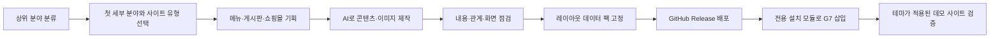

# 분야 체계와 레이아웃 데이터 제작 정책

작성: 2026-09-08. 첫 상품 대상 수정: 2026-09-09. 상태: 제품 분류·제작 단위 결정 문서. 분야별 실제 데이터와 설치 모듈은 아직 제작하지 않았습니다.

## 결정

분야를 먼저 정의하고, 분야마다 **사이트 목적·메뉴·게시판·쇼핑몰 필요 여부**를 기획한 뒤 레이아웃 데이터를 제작합니다.
다만 모든 하위 업종을 개별 상품처럼 만들지는 않습니다. 제작 단위는 업종명의 깊이가 아니라 **사이트 구조와 주요 행동이 달라지는가**로 결정합니다.

공식 용어는 다음과 같습니다.

| 용어 | 의미 |
|---|---|
| 분야 | 비슷한 고객·콘텐츠·사진 문법을 가진 상위 사업군 |
| 세부 분류 | 분야 안의 업종 후보. 제작 우선순위와 검색용 분류 |
| 테마군 | 일관된 디자인과 공통 페이지를 제공하는 상품 계열. 회사형·프로젝트형 등 |
| 사이트 유형 | 일반 페이지의 정보구조. 기업제품형·시공사례형·전문상담형 등. 예약·쇼핑은 기능 조합으로 구분 |
| 레이아웃 프로필 | 같은 테마에서 사용할 페이지·메뉴·섹션 순서와 초기 설정의 조합 |
| 업종 데이터 팩 | 해당 프로필에 맞는 업종별 문구·이미지·게시물·상품 등 완성 콘텐츠. 아래 레이아웃 데이터 팩과 같은 배포 단위 |
| 기능 모듈 | 예약·주문·매물 등 업무 데이터와 운영 규칙을 소유하는 G7 모듈. 테마는 공개 계약으로 화면을 연결 |
| 분야별 레이아웃 데이터 | AI로 사전 제작·점검한 메뉴·페이지·게시판·게시물·이미지·상품·옵션의 완성 데이터 |
| 레이아웃 데이터 팩 | 한 분야·사이트 유형·버전으로 묶은 실제 배포 ZIP |
| 레이아웃 데이터 설치 모듈 | 팩을 검사하고 G7의 실제 데이터로 삽입·연결하는 전용 모듈 |
| 데모 사이트 | 테마와 레이아웃 데이터 팩을 설치해 공개한 완성 예시 사이트 |

`더미 데이터`, `랜덤 데이터`, `벤치마크 데이터`는 이 제품의 명칭으로 사용하지 않습니다.
레이아웃 데이터는 화면 좌표만 뜻하지 않습니다. 디자인이 실제로 보이도록 필요한 콘텐츠와 기능 데이터를 모두 포함합니다.

## 상품은 네 구성 요소로 관리

분야와 세부 업종은 검색·시장 조사용 분류입니다. 실제 상품은 아래 네 요소를 조합하며, 업종마다 테마 코드를 복제하지 않습니다.

1. **테마:** 디자인·공통 페이지·목록과 상세의 표현·편집 규칙.
2. **레이아웃 프로필:** 업종에 필요한 메뉴·활성 페이지·섹션 조합.
3. **업종 데이터 팩:** 프로필을 채우는 실제 문구·이미지·샘플 콘텐츠와 관계.
4. **선택 기능 모듈:** 예약·쇼핑·매물·LMS 등 운영 기능과 해당 화면 연결.

기능 모듈은 테마나 팩의 하위 저장 엔진이 아닙니다. 독립 의존성이며, 각 상품 조합에서 필요한 모듈·버전·화면 범위를 명시합니다.

예를 들어 산업·제조 분야의 `산업설비`, `자동화 장비`, `공장용 부품`은 회사소개→제품→납품사례→기술자료→견적 문의 흐름이 같으면 **기업제품형 한 개**에서 다룹니다.
해당 회사가 온라인 결제를 사용한다면 기존 테마에 이커머스 모듈·쇼핑 화면·판매용 데이터 팩을 조합합니다. 주문 기능 추가만으로 새 테마를 만들지는 않으며, 추가 화면의 구현·검증 범위는 별도로 기록합니다.

## 권장 테마군과 묶을 수 있는 분야

아래 여섯 계열은 제작 후보입니다. 판매 순위·출시 순서·전부 제작한다는 확정이 아니며, 상품명은 가칭입니다. 실제 제작은 첫 테마부터 진행합니다.

| 테마군 | 함께 적용할 분야 | 공통 페이지 중심 | 세부 분야 대응 |
|---|---|---|---|
| JW BUSINESS | 일반회사·제조·IT·무역·물류·엔지니어링·전문서비스 | 회사·제품/서비스·사례·전문가·인증·자료·문의 | 제조·IT·물류·전문서비스 프로필과 업종 데이터 팩 |
| JW PROJECT | 건축·인테리어·조경·시공·디자인 | 프로젝트·전후사진·공정·후기·견적 | 사례 중심 표현이 필요할 때 별도 테마, 일반 소개는 BUSINESS 재사용 가능 |
| JW CLINIC | 병원·의원·치과·한의원·의료미용 | 의료진·진료·장비·시설·이용안내·상담 | 진료과별 콘텐츠·이미지·표현 기준을 팩으로 구분 |
| JW ACADEMY / PROGRAM | 학원·공부방·공방·PT·필라테스·요가 | 과정·강사·고정 일정·시설·후기·신청 안내 | 교육·운동별 프로필과 팩, 운영 예약·회원권은 선택 모듈 |
| JW PLACE | 숙박·식당·카페·웨딩·체험공간 | 공간/객실·메뉴·시설·갤러리·이용안내 | 공간 소개 기반을 공유하고 숙박·매장별 프로필/팩 제공 |
| JW COMMUNITY | 교회·협회·재단·비영리·지역센터 | 기관·사업·일정·소식·자료·참여 | 기관별 프로필과 콘텐츠 팩 |

부동산 중개사무소 소개는 BUSINESS로 구성할 수 있습니다. 매물 등록·검색·상태 관리까지 제공할 때는 매물 모듈과 전용 화면·데이터 팩이 필요합니다. 상품 카탈로그와 쇼핑몰도 같은 방식으로 구분합니다.
진료과·운동 종목·회사 업종 이름이 다르다는 이유만으로 별도 테마를 만들지 않습니다. 사진·문구만 다른 경우에는 데이터 팩으로, 전체 화면 구성과 표현이 달라지는 경우에는 별도 테마 후보로 판단합니다.

## 회사 테마의 공용 페이지와 업종별 구성

`JW BUSINESS 01`은 여러 기업 분야에 적용할 수 있는 회사 테마로 기획하고, 첫 완성 프로필과 데이터 팩은 전략·디지털 구축·운영개선을 제공하는 범용 B2B 기업으로 제작합니다.

| 공용 페이지 묶음 | 준비할 수 있는 일반 페이지 |
|---|---|
| 회사 | 회사소개·연혁·비전·조직·사업장·오시는 길 |
| 사업·제품 | 사업분야·서비스/솔루션 목록과 상세·제품 카탈로그와 사양 |
| 실적 | 수행사례·프로젝트 목록과 상세·납품사례 |
| 신뢰 | 전문가·팀·인증·파트너 |
| 정보·문의 | 뉴스·칼럼·기술자료·다운로드·가격 안내·FAQ·문의·견적 |

위 목록은 `JW BUSINESS 01`이 제공할 공통 페이지 라이브러리입니다. 상품 기획서에서 정한 회사·사업·제품/서비스·사례·정보·문의 화면을 첫 상품에 구현하고, 레이아웃 프로필은 그중 필요한 페이지만 활성화합니다. 첫 B2B 서비스 데모가 사용하지 않는 제품 카탈로그도 일반 기업 상품의 선택 페이지로 설계하되, 첫 데이터 팩에 빈 메뉴로 노출하지 않습니다.

| 프로필 예시 | 기본 메뉴 조합 |
|---|---|
| 제조·산업설비 | 회사소개 / 사업소개 / 제품소개 / 납품사례 / 고객지원 |
| IT·솔루션 | 회사소개 / 솔루션 / 도입사례 / 요금안내 / 자료·문의 |
| 물류·무역 | 회사소개 / 서비스 / 운송망·거점 / 수행사례 / 견적 문의 |
| 전문서비스 | 소개 / 업무분야 / 전문가 / 수행사례 / 칼럼·상담 |

메뉴 수는 콘텐츠에 따라 정합니다. 예를 들어 상위 메뉴 5~7개로 시작할 수 있지만 고정 제한은 아닙니다. 제공 가능한 모든 페이지를 기본 메뉴에 노출하지 않으며, 비활성 페이지로 향하는 링크를 남기지 않습니다. 프로필 변경·추가 설치는 고객이 편집한 페이지나 메뉴를 자동 교체하지 않습니다.

## 상위 분야와 기본 기획

아래는 판매용 테마와 레이아웃 데이터를 관리하기 위한 제품 분류입니다. 통계청 등 공식 산업분류를 대신하지 않습니다.
`필수`는 해당 사이트 유형의 완성 흐름에 필요하다는 뜻이고, `선택`은 별도 변형을 만들 때만 포함한다는 뜻입니다.

| 분야 | 대표 세부 분류 | 권장 사이트 유형 | 기본 메뉴 | 게시판 | 쇼핑몰 |
|---|---|---|---|---|---|
| 산업·제조 | 산업설비, 자동화, 기계·부품, 전기·전자부품, 산업안전 | 기업제품형 | 회사소개 / 사업분야 / 제품 / 납품사례 / 고객지원 | 공지·사례·기술자료·FAQ·견적 필수 | 선택 |
| 건축·인테리어 | 건축, 인테리어, 리모델링, 조경, 주문가구 | 시공사례형 | 회사소개 / 시공분야 / 프로젝트 / 진행과정 / 견적 | 공지·시공사례·전후사진·후기·FAQ·견적 필수 | 자재 판매 시 선택 |
| 전문·기업서비스 | 법무, 세무·회계, 노무, 경영컨설팅, IT·디자인 대행 | 전문상담형 | 소개 / 서비스 / 전문가 / 수행사례 / 인사이트 / 상담 | 공지·칼럼·사례·FAQ·상담 필수 | 기본 제외 |
| 생활·현장서비스 | 청소, 이사, 방역, 수리, 차량관리, 시설관리 | 지역서비스형 | 서비스 / 작업지역 / 작업사례 / 이용절차 / 요금안내 / 문의 | 공지·전후사례·후기·FAQ·견적 필수 | 기본 제외, 예약 선택 |
| 교육·문화 | 학원, 직업교육, 온라인 강의, 공방, 문화센터, 행사 | 교육프로그램형 | 과정 / 강사진 / 일정 / 수강후기 / 자료 / 신청 | 공지·과정·후기·자료·FAQ·질문 필수 | 교재·수강권 판매 시 선택 |
| 건강·뷰티 | 병원·의원, 미용실, 피부관리, 피트니스, 요가 | 의료안내형 또는 교육프로그램형 | 진료·프로그램 / 전문가 / 시설 / 안내 / 상담 | 공지·FAQ·문의, 후기 등은 업종별 기획 | 제품 판매 시 선택, 자체 예약 운영 시 예약 모듈 |
| 식품·농수산 | 식품 브랜드, 농장, 지역특산물, 베이커리, 카페·식당 | 기업제품형 또는 공간안내형 | 브랜드 / 상품·메뉴 / 생산이야기 / 이용안내 / 문의 | 공지·레시피·후기·FAQ·문의 필수 | 온라인 판매 시 필수, 매장 소개는 제외 가능 |
| 여행·숙박·레저 | 펜션, 호텔, 캠핑, 여행상품, 체험, 레저시설 | 공간안내형 | 객실·상품 / 패키지 / 시설 / 주변안내 / 이용안내 / 예약 안내 | 공지·갤러리·후기·FAQ·문의 필수 | 기본 제외, 외부 예약 연결 또는 자체 예약 모듈 선택 |
| 기관·단체·커뮤니티 | 협회, 비영리단체, 종교기관, 지역센터, 동호회 | 정보커뮤니티형 | 기관소개 / 사업·프로그램 / 일정 / 소식 / 자료 / 참여·문의 | 공지·소식·갤러리·자료·질문 필수 | 기본 제외 |
| 브랜드·전문 쇼핑몰 | 패션, 뷰티제품, 생활용품, 전자기기, 반려동물용품 | 브랜드·상품 소개 + 이커머스 기능 조합 | 상품분류 / 신상품 / 인기상품 / 기획전 / 브랜드 / 고객지원 | 공지·이벤트·후기·상품문의·FAQ 필수 | 온라인 판매 운영에 필수 |
| 부동산 | 개별 중개사무소, 상업용·주거용 매물 | 전문상담형 + 매물 기능 선택 | 사무소 / 중개분야 / 지역안내 / 문의, 매물 운영 시 목록·상세 추가 | 공지·지역정보·문의 | 기본 제외, 매물 운영 시 전용 모듈 |

병원·법무처럼 내용 책임과 광고 표현 제한이 큰 세부 분류는 같은 사이트 유형을 재사용하더라도 별도 콘텐츠 검토 기준을 둡니다.
예약·매물처럼 전용 기능 모듈이 준비되지 않은 유형은 화면만 꾸며 완료 처리하지 않습니다.

## 사이트 유형별 공통 골격

상위 분야마다 모든 코드를 새로 만들지 않습니다. 아래 골격을 프로필의 설계 기준으로 사용하고, 실제 문구·상품·사진은 분야별 레이아웃 데이터로 채웁니다. 골격을 전부 선행 구현하지 않으며 첫 테마의 필요와 두 번째 실제 재사용으로 공통화합니다.

| 사이트 유형 | 방문자의 핵심 흐름 | 핵심 데이터 | 별도 기능 |
|---|---|---|---|
| 기업제품형 | 사업 이해 → 제품 탐색 → 사례·자료 확인 → 견적 | 제품·사양·사례·기술자료 | 상품 카탈로그, 견적 게시판 |
| 시공사례형 | 스타일·시공 분야 → 프로젝트 → 과정·후기 → 견적 | 프로젝트·전후사진·공정·후기 | 갤러리, 견적 게시판 |
| 전문상담형 | 문제 확인 → 서비스·전문가 → 수행사례·칼럼 → 상담 | 서비스·전문가·사례·인사이트 | 상담 게시판 |
| 지역서비스형 | 서비스·지역 → 작업사례·요금 → 견적·예약 | 서비스 지역·작업 전후·요금 | 견적, 필요 시 예약 |
| 교육프로그램형 | 과정 → 강사·일정 → 후기·자료 → 신청 | 과정·강사·일정·후기 | 신청 또는 결제 선택 |
| 의료안내형 | 진료 이해 → 의료진·시설 → 이용안내 → 상담 | 진료·의료진·장비·시설·안내 | 문의 또는 외부 예약 연결, 자체 예약은 선택 모듈 |
| 공간안내형 | 객실·공간·메뉴 → 시설·이용안내 → 문의·예약 안내 | 공간·객실 소개·메뉴·시설·갤러리 | 외부 예약 연결, 자체 예약은 선택 모듈 |
| 정보커뮤니티형 | 기관·사업 이해 → 일정·소식·자료 → 참여 | 프로그램·일정·소식·자료 | 게시판 중심 |

공통 골격은 메뉴 슬롯·데이터 스키마·필요 모듈·검사 규칙을 줄이는 장치입니다.
같은 골격이라고 해서 산업설비의 문구·사진을 세무사나 미용실에 이름만 바꿔 재사용하지 않습니다.

## 세부 분류를 별도 제작하는 기준

| 달라지는 내용 | 제작 단위 |
|---|---|
| 메뉴명·페이지 선택·섹션 순서·초기 설정 | 같은 테마의 프로필 또는 설정 |
| 업종 용어·사진·사례·대표 사업체·콘텐츠 표현 기준 | 같은 테마/골격을 사용하는 별도 데이터 팩 |
| 전체 화면 구성·정보 밀도·목록과 상세의 표현·편집 방식 | 별도 테마 후보. 기존 테마의 변형으로 수용 가능한지 먼저 확인 |
| 예약 가능 여부·주문·재고·매물 상태·수강권 등 업무 데이터와 처리 규칙 | 별도 기능 모듈 및 연결 화면. 해당 조합용 데이터 팩도 필요 시 제작 |

하나의 차이를 이유로 네 요소를 모두 새로 만들지 않습니다. 별도 테마·팩의 제작은 실제 요구와 판매 근거를 함께 판단합니다.

작은 메뉴 순서나 명칭 차이는 새 팩을 만들지 않고 기존 팩의 설정이나 테마 표현으로 처리합니다.
분리 기준에 해당해도 시장성이 확인되지 않으면 분류표에만 남기고 제작하지 않습니다.

예시:

- `산업설비`와 `공장 자동화 장비`: 기업제품형 골격과 제품·사례 흐름이 같으므로 실제 수요가 확인되면 한 팩에서 시작할 수 있습니다.
- `산업설비 견적형`과 `산업용품 온라인몰`: 최종 행동과 상품·결제 구조가 달라 별도 팩입니다.
- `인테리어`와 `조경 시공`: 골격은 같아도 사진·공정·사례가 크게 다릅니다. 두 번째 실제 수요가 생길 때 별도 팩으로 제작합니다.
- `미용실`과 `펜션`: 둘 다 예약을 쓰지만 프로그램·객실 데이터와 사진 문법이 달라 같은 팩을 쓰지 않습니다.

## 기능 모듈과 별도 개발의 경계

별도 모듈이 필요하다는 말은 신규 개발이 확정됐다는 뜻이 아닙니다. 기존 G7 모듈의 공개 계약과 지원 버전을 먼저 확인하고, 없는 기능만 별도 개발 범위로 기록합니다.

| 기능 | 테마에서 제공할 범위 | 별도 모듈·연결 개발이 필요한 범위 |
|---|---|---|
| 문의·견적 | 실제 G7 게시판 접수 화면 | 배정·진행 단계·승인·CRM 처리 |
| 전화·지도·외부 예약 | 링크·안내, 필요한 외부 지도 연결 | 외부 서비스와 예약 상태를 양방향 동기화하는 기능 |
| 제품 소개 | 카탈로그·사양·자료·견적 연결. 원본은 G7/지원 모듈 사용 | 옵션별 재고·장바구니·주문·결제·배송·환불 |
| 실시간 예약 | 예약 모듈이 제공하는 화면과 오류 상태 표현 | 가능 시간·담당자·정원·확정·취소·중복 예약 방지 |
| 숙박 예약 | 객실·시설 소개와 예약 화면 표현 | 객실별 숙박일 재고·인원·날짜별 요금·취소·채널 동기화 |
| 부동산 | 사무소 소개·문의, 매물 모듈의 목록/상세 표현 | 매물 등록·수정·거래 상태·가격·주소·지도 검색·필터·만료 |
| 교육·회원권 | 과정·강사·공개 일정·신청 안내 | 수강권·횟수 차감·대기·출결·진도·콘텐츠 접근 권한 |
| 다지점 | 고정 지점 목록·주소·연락처 | 지점별 권한·운영 상태·주문·예약 관리 |

페이지의 일반 편집·게시판 저장 자체를 신규 업무 모듈로 분류하지 않습니다. 업무에 고유한 데이터 구조·상태 전이·재고/정원 제약·권한·외부 동기화가 생기는지를 판단합니다.
기능형 상품은 모듈 이름·버전·설치 조건·원본 소유자·추가 화면·실제 확인한 사용자 흐름을 명시합니다. 외부 링크, 희망 시간 문의, 사이트 내 예약 확정을 서로 같은 예약 기능으로 표기하지 않습니다.

### 예약 방식별로 분리할 운영 규칙

| 예약 분야 | 주요 운영 데이터 |
|---|---|
| 병원·뷰티 | 담당자·진료/시술 시간·준비 안내·취소 |
| 학원·운동 | 반복 수업·정원·수강권·대기·출결 |
| 숙박 | 객실·체크인/아웃·박수·인원·시즌 요금·최소 숙박·채널 재고 |
| 식당 | 인원·테이블·회전 시간·예약금·노쇼 |

달력이나 시간 선택 UI는 재사용할 수 있으나, 이 표만으로 범용 예약 엔진을 선행 개발하지 않습니다. 첫 실제 예약 요구를 기준으로 모듈 계약을 정하고 공통화 가능 범위를 확인합니다.

## 제작 범위를 줄이는 운영 원칙

### 1. 분류는 넓게, 실제 제작은 한 개씩

상위 분야와 세부 분류는 미리 문서화하되, 레이아웃 데이터는 첫 테마에 필요한 것부터 완성합니다.
빈 폴더나 이름만 다른 팩을 미리 만들지 않습니다.

### 2. 한 팩은 대표 사업체 한 곳을 완성

첫 팩은 `B2B 비즈니스 서비스 기업` 한 곳을 실제 홈페이지처럼 완성합니다. 여러 기업 업종을 이름만 바꿔 얕게 섞지 않습니다.
해당 데이터가 자연스럽게 맞는 범위까지만 적용 가능 업종으로 표시합니다.

### 3. 구조와 콘텐츠의 재사용을 분리

- 재사용 가능: 메뉴 슬롯, 게시판 유형, 상품·옵션 스키마, 삽입 순서, 검증 규칙.
- 분야마다 제작: 회사 설정, 문구, 게시물, 상품, 사례, 옵션값, 이미지.
- 재사용 금지: 업종명만 바꾼 동일 본문, 무관한 공유 이미지, 임의 가격·상품 관계.

### 4. 기본형과 기능형을 분리

한 분야에서 기업소개와 쇼핑몰을 모두 한 팩에 억지로 넣지 않습니다.
기본형을 먼저 만들고, 실제 판매 가치가 있을 때 `쇼핑 포함`, `예약 포함` 같은 기능형 팩을 추가합니다.

### 5. 긴 꼬리는 테마 편집성으로 대응

모든 세부 업종에 완성 데이터를 제공한다고 약속하지 않습니다.
전용 팩이 없는 업종도 구매자가 자기 콘텐츠로 바꿀 수 있도록 테마의 편집 구조와 문서를 제공합니다.

## 분야 기획서 완료 조건

한 분야가 아래 항목을 갖춰야 레이아웃 데이터 제작으로 넘어갑니다.

1. 대표 사업체와 방문자, 주요 전환 행동.
2. 테마·사이트 유형·레이아웃 프로필·데이터 팩 구성과 적용 가능한 세부 분류 범위.
3. PC·모바일·푸터의 메뉴 트리와 모든 도착점.
4. 필요한 고정 페이지와 각 페이지의 콘텐츠 항목.
5. 게시판 이름·목적·목록 형태·필요 게시물 수·이미지와 첨부 유형.
6. 쇼핑몰 `필수 / 선택 / 제외`와, 포함 시 분류·상품 수·옵션·가격·재고·배송 흐름.
7. 예약·매물·상담 등의 외부 연결/기존 모듈/별도 개발 구분, 지원 계약·원본 소유자·추가 화면·준비되지 않은 기능. 미준비 기능이 핵심이면 기본형으로 범위를 조정하거나 기능형 제작을 보류.
8. 상품·사례·자료 사이의 참조 관계.
9. 이미지 제작 목록과 동일 사업체로 보이게 할 시각 규칙.
10. 콘텐츠·이미지의 사용·재배포 범위와 품질 검사.

문서에 이름만 나열되어 있거나 실제 모듈이 없는 기능을 화면으로만 표현한 상태는 기획 완료가 아닙니다.

## 제작과 배포 순서



독립 레이아웃 데이터 프로젝트를 먼저 준비하고 분야별 데이터셋과 사이트 구성 설치 모듈을 함께 기획합니다. 실제 Release는 대표 데이터의 생성·연결과 전체 팩을 검증한 뒤 발행합니다.

레이아웃 데이터 저장소는 하나로 시작하고 설치 모듈도 같은 프로젝트에서 함께 관리합니다. 소스 영역과 배포 ZIP을 구분하며, 추가 배포 저장소는 실제 G7 업데이트 제약을 확인한 뒤 결정합니다. 최신 경계는 [인계 문서](layout-data-module-and-release-plan.md)를 따릅니다.

```text
jwsoft-g7-layout-data/
  catalog/
    fields.json                 설치 화면용 분야·팩 목록
  schemas/
    layout-data-pack.schema.json
  packs/
    industrial/
      equipment-company/
        1.0.0/
  docs/
```

GitHub Release는 저장소 폴더가 아니라 태그에 연결된 배포 자산입니다. 실제 자산명 예시는 `industrial-equipment-company-layout-data-1.0.0.zip`입니다.
저장소 이름은 jwsoft-g7-layout-data입니다. 위 팩 폴더와 실제 데이터·Release는 아직 제작하지 않았습니다.

판매용 테마 소스는 현재 비공개 테마 저장소에 유지합니다. 2026-09-08 확인 기준 `jiwonpapa/jwsoft-g7-themes`는 비공개 저장소입니다. 레이아웃 데이터의 공개 여부는 이미지·콘텐츠 권리와 판매 방식을 보고 결정합니다.

- 공개 배포가 가능한 팩: 별도 공개 저장소와 고정 버전 Release를 설치 모듈이 내려받음.
- 유료 테마 전용 팩: 비공개 원본에서 검증된 ZIP을 만들고 테마 상품에 동봉하거나 구매자용 배포 경로 사용.
- 두 경우 모두 설치 후 게시물·상품·이미지는 고객 G7에 저장되며 GitHub 주소에 의존하지 않음.

## 첫 제작 범위

1. 상위 분야 표는 이 문서로 관리합니다.
2. 첫 테마 제작 대상은 일반 기업 홈페이지용 `JW BUSINESS 01`이며, 실제 첫 데이터 팩은 `전문·기업서비스 > B2B 비즈니스 서비스 > 전문상담형` 하나입니다.
3. 독립 프로젝트에서 메뉴별 데이터셋·팩 규격과 G7 객체 생성·연결 모듈을 함께 기획합니다.
4. 대표 실제 데이터 묶음으로 게시판·분류 생성, 분류별 상품·게시물·이미지 등록, 메뉴 연결을 실증합니다.
5. [JW BUSINESS 01](../themes/business/jw-business-01/product.md)의 전체 구성을 같은 계약에 따라 확장하고 검사합니다.
6. 후속 후보는 같은 BUSINESS의 IT·물류·전문서비스 프로필/팩, 사례 중심 PROJECT 테마, 이커머스 모듈을 연결한 기능형 팩으로 구분합니다. 실제 요구·판매 근거·지원 모듈을 확인해 하나씩 선택하며 후속 제작 순서는 미확정입니다.

이 방식이면 모든 하위 분류를 개별 제작하지 않으면서도, 공개 데모에 사용하는 데이터는 실제 업종에 맞는 완성 콘텐츠로 유지할 수 있습니다.
