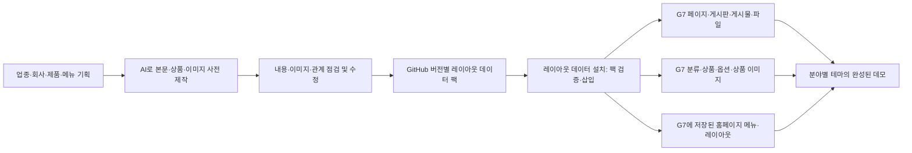

# 분야별 레이아웃 데이터 — 타당성 조사

작성·소스 확인: 2026-09-08. 첫 팩 대상 수정: 2026-09-09. 대상: 첫 테마 `jw-business-01`과 이후 분야별 테마의 레이아웃 데이터 설치.
상태: 조사·설계 제안. 모듈 수정, 이미지 생성, 실제 데이터 삽입, GitHub 저장소 생성·게시·배포는 하지 않았습니다.

> 2026-09-09 정정: 초기 산업설비 우선안은 [SIR 첫 테마 수요 재검토](sir-first-theme-demand-recheck-2026-09-09.md)로 폐기했습니다. 현재 첫 팩은 범용 B2B 비즈니스 서비스 기업이며, 아래 산업설비·쇼핑 예시는 후속 기업제품형과 기능형 팩의 요구를 설명하는 참고자료입니다.

## 결론

**AI로 분야별 홈페이지 콘텐츠와 이미지를 사전에 제작·점검해 레이아웃 데이터 팩으로 배포하고, 전용 설치 모듈은 그 팩을 실제 G7 데이터로 삽입합니다.**
메뉴를 눌렀을 때 실제 게시판과 게시물이 열리고, 첨부 이미지가 표시되며, 상품 옵션과 장바구니가 실제 데이터로 동작해야 테마의 디자인과 사용 경험을 검증할 수 있습니다.

사용자가 설명한 지원학습 방식처럼, AI 제작과 콘텐츠 점검은 개발 단계에서 수행하고 고객은 완성된 결과를 설치합니다. 지원학습의 현재 내부 구현을 이번에 조사했다는 뜻은 아닙니다.
`sirsoft-benchmark`는 사용자 제작의 성능 시험용 생성기입니다. 기존 랜덤 데이터·사전 조합·이미지 풀을 레이아웃 데이터의 기반으로 삼지 않습니다.
앞선 '기존 생성기 확장 우선' 권고는 철회합니다. **벤치마크 모듈·데이터·생성 코드는 이번 설계에서 제외합니다.** 분야별 레이아웃 데이터 팩과 이를 G7에 넣는 전용 설치 모듈을 설계합니다.

GitHub는 원본 관리와 설치 파일 배포에 적합합니다. **Git 저장소의 JSON·최적화 이미지 → GitHub Releases의 분야별 레이아웃 데이터 팩 → G7 저장소에 실제 삽입** 구조가 적절합니다.
판매용 테마 소스가 있는 현재 비공개 저장소의 공개 전환을 뜻하지 않습니다.

## 조사 근거와 타당성

| 검토 항목 | 판정 | 근거·조건 |
|---|---|---|
| 완성된 데모의 제품 가치 | 필요 | 빈 목록·가짜 링크로는 내부 페이지, 긴 본문, 이미지, 옵션·목록 복귀 흐름을 판단할 수 없음 |
| 실제 게시물·상품 삽입 | 구현 가능성이 높음 | G7 각 모듈의 생성·첨부·옵션 처리 코드가 존재. 설치 실증은 아직 미실시 |
| 벤치마크 모듈·데이터·생성 코드 활용 | 제외 | 성능 측정용 데이터 삽입은 이번 홈페이지 콘텐츠 제작·설치의 범위가 아님 |
| AI 사전 제작 + 고정 팩 삽입 | 권장 방향 | 개발 단계에서 내용·사진·관계를 점검하고 같은 버전의 완성 콘텐츠를 재현 가능하게 설치 |
| 이미지까지 분야별 제작 | 필요 | 임의 사진·공유 이미지 풀은 상품 이름·사양·사례와 의미가 맞지 않음 |
| 모든 업종 동시 제작 | 후순위 | 첫 범용 B2B 기업 팩으로 규격을 검증한 뒤 두 번째 실제 업종에서 공통화 |
| GitHub 배포 | 적합 | 버전별 소스와 Release 자산 제공 가능. 재배포 권리와 공개 범위를 구분해야 함 |

수요 증가율·전환율·예상 매출은 측정하지 않았습니다. 따라서 수익 개선 수치를 제시하지 않습니다.
이 작업의 직접 가치는 데모 재현성, 콘텐츠 교체 후 디자인 확인, 테마별 수작업 세팅 감소입니다.

### 벤치마크 모듈은 이번 설계에서 제외

로컬 `modules/_bundled/sirsoft-benchmark/module.json` 버전은 `0.3.1`이며 설명은 대용량 게시판·쇼핑몰 벤치마크 데이터 생성입니다.
현재 G7 체크아웃에서 해당 디렉터리는 추적되지 않은 사용자 코드입니다. 이 상태만으로 원격 저장소나 운영 서버에 없다고 단정하지 않습니다.

이름과 목적이 명시된 성능 측정용 데이터 삽입 모듈입니다. 홈페이지 데모를 위한 확장·개선 대상이 아니며, 이번 작업에서 해당 모듈의 구조를 개편하거나 생성 코드를 가져오지 않습니다.
소스에서 확인한 제목 조합·공통 문장·임의 상품·공유 이미지는 성능 시험 데이터의 성격을 보여주는 근거입니다. 이번에 필요한 것은 업종의 회사·제품·사례를 AI로 사전 제작하고 점검한 별도의 완성 콘텐츠입니다.

### 제작자가 sirsoft로 표시되는 원인

사용자가 제작한 모듈인데 현재 `module.json`의 `vendor`가 `sirsoft`입니다. `AbstractModule::getVendor()`는 이 값을 우선 읽고, 관리자 모듈 목록·상세는 응답의 `vendor`를 표시합니다.
따라서 제작자 표시의 직접 원인은 모듈 메타데이터입니다. 현재 소스만으로 최초 작성자가 그 값을 선택한 경위는 확인할 수 없으며, 공식 모듈 복사나 기본값 잔존이라고 단정하지 않습니다.

표시 제작자는 프로젝트 브랜드인 **JW SOFT**로 바로잡는 것이 맞습니다. 표시 이름 수정과 기술 식별자 변경은 분리합니다.
`sirsoft-benchmark` 식별자는 디렉터리·PHP namespace·Composer autoload·API·권한·핸들러에 사용됩니다. 식별자까지 변경하려면 기존 설치 정보와 참조의 이전을 확인해야 하며, `sirsoft-board`·`sirsoft-ecommerce` 같은 실제 의존 모듈명은 변경 대상이 아닙니다.
이번에는 원인을 문서화했으며 다른 저장소의 모듈 코드는 수정하지 않았습니다.

### G7 기본 샘플과 정상 기능

G7 기본 샘플 시더도 레이아웃 데이터와 별도입니다. 게시판 샘플은 그라디언트 시험 이미지를 만들고, 이커머스 샘플은 여러 업종의 상품과 `picsum.photos` 이미지를 사용합니다.
이커머스 기본 시더에는 조합 옵션 예제가 있어 입력 형식 참고에 유용하지만, 분야별 레이아웃 데이터로 그대로 배포하기에는 내용과 이미지가 맞지 않습니다.
근거: [게시판 샘플](https://github.com/gnuboard/g7-module-sirsoft-board/blob/1.1.1/database/seeders/Sample/PostSampleSeeder.php), [상품 샘플](https://github.com/gnuboard/g7-module-sirsoft-ecommerce/blob/1.2.1/database/seeders/Sample/ProductSeeder.php).

정상 생성 경로도 있습니다. 게시물 생성은 첨부 연결과 훅·캐시 처리를 수행하며, 상품 생성은 분류·옵션·이미지·추가옵션을 함께 처리합니다.
따라서 레이아웃 데이터를 별도 가짜 API로 보여줄 이유가 없습니다. 설치 모듈에서 대상 버전의 서비스 계약을 검증하고 호출하는 어댑터가 필요합니다.
근거: [PostService](https://github.com/gnuboard/g7-module-sirsoft-board/blob/1.1.1/src/Services/PostService.php), [ProductService](https://github.com/gnuboard/g7-module-sirsoft-ecommerce/blob/1.2.1/src/Services/ProductService.php).

## 권장 구성



### 책임 구분

- **레이아웃 데이터 팩:** 분야의 회사정보·메뉴 구조·페이지 내용·게시판·게시물·분류·상품·옵션·이미지와 참조 관계.
- **AI 제작 작업:** 업종 기획에 따라 게시물·상품 설명·사양·옵션·이미지를 사전 제작하고 일관성을 점검·수정.
- **레이아웃 데이터 설치 모듈:** 완성된 팩 선택·검증·버전 확인·다운로드·실제 삽입·진행 표시·재개·설치 이력·선택 제거.
- **G7와 기능 모듈:** 콘텐츠 원본·인증·권한·파일 저장·상품 옵션·장바구니·편집 버전.
- **테마:** 설치된 콘텐츠를 표현하는 레이아웃·색상·컴포넌트·공개 편집 규격.

설치 기능이 보관할 것은 설치 작업과 `팩 항목 → 생성된 G7 객체`의 대응 정보입니다. 게시물·상품·메뉴 원본을 별도 DB에 중복 보관하는 콘텐츠 엔진은 만들지 않습니다.
레이아웃 데이터 팩에는 PHP·SQL·실행할 JavaScript를 넣지 않습니다. 테마별 표시 위치 연결은 테마 어댑터가 담당합니다.

### AI 사전 제작과 점검 절차

1. **한 업종의 사업체 설정:** 무엇을 공급하고 누구의 어떤 문제를 해결하는 회사인지 정합니다. 메뉴·사업·상품 분류·용어·사진 분위기를 같은 설정에서 설계합니다.
2. **상품 원본 설계:** 상품마다 고정 키·모델명·용도·규격·옵션 조합·가격 관계·사진 제작 목록을 먼저 작성합니다. 분류·가격·옵션을 서로 독립적으로 무작위 배정하지 않습니다.
3. **AI로 콘텐츠·이미지 제작:** 상품 상세, 공지, 기술자료, 사례, FAQ, 문의 예시를 각각의 목적에 맞게 작성하고 실제 이미지 파일을 제작합니다. 모든 항목은 그 자체로 읽을 수 있는 완성 콘텐츠여야 합니다.
4. **연결 관계 점검:** 사례에 등장한 제품이 실제 상품 목록에 있는지, 사진과 규격·선택 옵션이 맞는지, 기술자료·FAQ의 설명과 상품 조건이 일치하는지 확인하고 수정합니다.
5. **화면과 데이터 점검:** 대표 상세와 목록을 확인하고, 남은 항목도 내용·이미지·참조가 빠지지 않았는지 확인합니다. 이후 같은 버전의 JSON·파일·해시를 고정하여 배포합니다.

이 점검은 AI가 생성했다는 이유로 생략하지 않습니다. 개발 작업에서 실제 내용과 이미지를 검토하며, 매 항목마다 사용자에게 별도 승인을 요구하는 절차를 추가하지 않습니다.

| 검사 층위 | 확인 사항 | 부족한 판정 방식 |
|---|---|---|
| 내용 | 해당 업종의 고객이 읽을 법한 정보·질문·사례인지, 의미가 중복되지 않는지 | 글자 수와 JSON 형식만 통과 |
| 상품 | 용도·사양·가격·옵션·이미지가 같은 제품을 설명하는지 | 상품명만 바꾼 공통 설명 |
| 이미지 | 상품 외형·각도·현장 연속성·사진과 본문의 의미가 맞는지 | 파일 존재·해상도만 확인 |
| 관계 | 메뉴→분류→상품→사례→자료가 실제 대상에 연결되는지 | URL이 200을 반환하는지만 확인 |
| 동작 | 옵션·추가금·재고·장바구니·게시판이 저장된 데이터로 동작하는지 | 화면에 선택 상자만 표시 |

고객 서버는 AI 생성 작업을 수행하지 않습니다. ‘레이아웃 데이터 설치’는 사전에 완성한 팩을 가져와 삽입하는 기능입니다.
팩에 내용이 빠졌을 때 임의 문장이나 무관한 이미지로 채워 성공 처리하지 않습니다. 제작 단계에서 고친 새 팩 버전으로 해결합니다.

설치 코드는 `팩 읽기 → 형식·참조 검사 → 삽입 계획 → G7 객체별 저장 → 메뉴·레이아웃 연결 → 설치 결과 기록`으로 책임을 나눕니다.
이 경계는 구현 계약이며 공통 프레임워크나 새 작업 엔진을 먼저 만들라는 뜻이 아닙니다.

### 메뉴는 별도 연결 실증이 필요

G7 `MenuService`에는 메뉴 CRUD가 있지만, 이것만 호출하면 홈페이지 헤더·모바일 메뉴가 자동으로 완성된다고 볼 수 없습니다.
현재 기본 테마의 `_user_base.json`은 공개 게시판 메뉴 API와 레이아웃에 정의된 링크를 함께 사용합니다.
따라서 관리자 메뉴, 홈페이지 메뉴, 쇼핑 분류를 구분해야 합니다.

권장안은 레이아웃 데이터 팩에 논리적인 메뉴 트리를 두고, 해당 테마가 공개한 메뉴 편집 영역에 G7 레이아웃 저장 계약으로 적용하는 것입니다.
PC·모바일은 같은 메뉴 원본을 사용합니다. 메뉴 링크는 데이터 삽입 후 얻은 실제 ID·slug로 해석합니다.
기존 홈페이지에서는 덮어쓰기를 기본값으로 삼지 않으며, 새 데모 메뉴 적용 범위를 설치 화면에 표시합니다.

G7 `LayoutService::updateLayout`에는 버전 저장·캐시 처리와 `expected_lock_version` 확인이 있습니다. 정상 저장 경로를 사용해야 합니다.
지원 테마에 메뉴 연결 계약이 없으면 ‘데이터 설치 가능 / 홈페이지 메뉴 자동 구성 미지원’으로 표시합니다. 메뉴 자동 구성을 성공 처리하지 않습니다.

## 첫 레이아웃 데이터 팩의 구체적 범위

분야·사이트 유형·별도 팩 생성 기준은 [분야 체계와 제작 정책](../field-taxonomy-and-layout-data-policy.md)을 따릅니다.

첫 대상은 [JW BUSINESS 01 기획서](../../themes/business/jw-business-01/product.md)의 범용 B2B 비즈니스 서비스 기업입니다.
아래 수량은 제작 목표이며 현재 존재하는 데이터 수가 아닙니다.

| 구성 | 1차 제작 목표 | 디자인에서 확인할 내용 |
|---|---|---|
| 회사·서비스 페이지 | 홈용 콘텐츠, 소개·연혁·비전, 서비스 3개, 연락·위치 안내 | 한 회사로 이어지는 내용·표현 |
| 메뉴 | 회사소개·서비스·프로젝트·인사이트·문의와 하위 메뉴 | PC·모바일·푸터 실제 이동 |
| 공지사항 | 12건, 목록 6개씩 | 2페이지·공지 표시·긴 제목·검색 |
| 프로젝트 | 12건, 목록 6개씩 | 갤러리 2페이지·문제·과정·성과의 연결 |
| 인사이트 | 12건, 목록 6개씩 | 칼럼 2페이지·긴 본문·관련 서비스 연결 |
| FAQ | 8건 | 계약·진행 절차·산출물·운영지원 관련 문답 |
| 문의 예시 | 6건 | 실제 게시물과 답변 상태. 개인 연락처는 사용하지 않음 |
| 팀·신뢰 콘텐츠 | 역할 6명, 파트너 8개, 업무 원칙 4개 | 과장된 실적·실존 고객 오인 없이 신뢰 영역 표현 |

첫 팩은 쇼핑몰이 없는 일반 기업 테마이므로 상품 분류·가격·재고·장바구니 데이터를 넣지 않습니다. 서비스 상세 3개와 프로젝트 상세 12개는 목록의 장식용 카드가 아니라 각각 일관된 본문·이미지·관련 링크를 가집니다. 수량을 채우기 위한 같은 글의 반복이나 관계없는 사진 배정은 피합니다.

### 후속 기업제품형·쇼핑형 팩 기준

| 상품 | 선택 항목 | 실제 저장할 데이터·검증 |
|---|---|---|
| 모듈형 이송 컨베이어 CV-100 | 길이 1m/2m × 폭 300/500mm | 4개 사양 조합, 사진·규격·견적 선택값 일치 |
| 조립식 작업대 WB-120 | 폭 1200/1500/1800mm × 상판 일반/정전기 방지 | 6개 사양 조합, 조립 서비스 추가 선택 |

모델명·규격은 데모용 기획입니다. 실제 제조사의 성능·인증으로 표시하지 않습니다.
산업설비 같은 기업제품형을 후속 제작할 때는 공개 가격·재고·장바구니를 기본 완료 조건으로 두지 않습니다. 선택한 사양이 견적 문의 내용에 정확히 전달되는지를 확인합니다.

`산업용품 쇼핑몰형`은 별도 팩으로 제작합니다. 이때 안전용품·소모품 등 실제 온라인 판매에 맞는 분류, 상품 24개와 목록 2페이지, 대표 상세 2개를 준비합니다.
보이는 선택 상자만 만드는 것으로 완료하지 않습니다. 선택한 조합 ID·추가옵션·수량을 실제 장바구니 API가 받고, 재조회해도 같은 조합·금액이 나와야 합니다.
현재 G7 이커머스에는 상품 조회와 장바구니 생성·옵션 변경 API가 있습니다. 근거: [이커머스 라우트](https://github.com/gnuboard/g7-module-sirsoft-ecommerce/blob/1.2.1/src/routes/api.php).

### 다른 분야로 확장할 때

| 분야 예시 | 회사·게시판 메뉴 | 쇼핑 분류·옵션 예시 |
|---|---|---|
| 건축·인테리어 | 시공분야·시공사례·자재자료·견적 문의 | 조명·수전·손잡이·마감재, 색상·규격·수량 단위 |
| 뷰티·생활용품 | 브랜드·사용법·소식·FAQ | 클렌징·스킨케어·바디·도구, 용량·향·묶음 구성 |
| 식품·지역특산물 | 생산이야기·보관법·배송안내·문의 | 곡물·차·가공식품·선물세트, 중량·포장·구성 |

이는 팩 설계 예시이며 제작 확정 업종 목록이 아닙니다. 업종 이름만 바꾸고 같은 데이터·옵션을 재사용하지 않습니다.
후기 화면이 필요하면 합성 데모 후기임을 표시하고 실제 고객 후기나 판매 실적으로 보이게 만들지 않습니다.

## 이미지 제작과 데이터 파일 규격

이미지 제작은 실제 삽입 코드보다 먼저 목록을 기획하고, 대표 제품·사례부터 제작합니다. 전체 대량 생성은 파일 연결 최소 실증과 도안 방향을 확인한 뒤 진행합니다.

| 이미지 묶음 | 제작 기준 |
|---|---|
| 회사·서비스 | 메인용 가로 사진, 서비스 3개, 협업·실행 장면. 여러 페이지에서 자연스럽게 재사용 |
| 프로젝트 | 12개 프로젝트 각각 대표·과정 이미지. 같은 프로젝트의 연속성이 보여야 함 |
| 인사이트 | 주제별 대표 이미지와 필요한 도해. 제목·수치는 편집 가능한 콘텐츠로 작성 |
| 팀·신뢰 | 역할별 인물 이미지와 파트너 표시용 비상표 그래픽. 실존 고객·자격으로 오인시키지 않음 |

프로젝트·인사이트·회사·서비스를 포함해 초기 35~45개 수준을 예상합니다. 이는 산출 계획이며 생성 완료 수가 아닙니다.
리사이즈·썸네일은 별도 원본 작품으로 세지 않습니다. 같은 프로젝트의 이미지에서 공간·인물·맥락이 갑자기 달라지지 않는지 확인합니다.
AI 이미지를 사용하면 제작 도구·원본·편집 이력과 배포 허용 범위를 기록합니다. 고객 서버에서 이미지 생성 API를 호출하거나 키를 요구하지 않습니다.

제안 파일 구조는 다음과 같습니다. 아직 실제 데이터 파일은 없습니다.

```text
packs/business/b2b-services/1.0.0/
  manifest.json          팩·스키마 버전, 지원 조합, 항목 수, 파일 해시
  site.json              가상 회사정보와 공통 문구
  menus.json             논리적인 메뉴 트리와 대상 참조
  pages.json             소개·사업 등의 콘텐츠
  boards.json            게시판 유형·노출·권한·페이지 크기
  posts.json             공지·프로젝트·인사이트·FAQ·문의 본문과 관계
  media.json             파일 키·경로·대체텍스트·크기·해시·권리
  media/                 최적화한 실제 이미지와 첨부자료
  LICENSE-CONTENT.md      콘텐츠·이미지의 사용 및 재배포 조건
  CHANGELOG.md
```

고정 DB ID나 원본 서버 URL 대신 `service:digital-delivery`, `board:insights`, `media:workflow-unification` 같은 팩 내부 키를 사용합니다.
본문의 이미지와 내부 링크도 설치 시 실제 저장 URL·ID로 변환합니다. 설치 완료 후 GitHub 연결을 끊어도 이미지·게시물이 열려야 합니다.
팩 버전과 테마 버전을 분리하여 같은 팩을 여러 디자인에 적용할 수 있게 합니다.

## 설치 버튼의 실제 동작

관리 화면은 ‘분야별 레이아웃 데이터 설치’로 설계합니다. 제공할 팩은 AI 사전 제작과 점검을 마친 고정 콘텐츠이며, 화면에는 설치 대상과 결과를 표시합니다.

1. 분야를 선택하면 미리보기, 포함 메뉴·콘텐츠·상품 수, 필요한 모듈·지원 테마, 설치 버전·다운로드 용량을 보여줍니다.
2. **‘이 분야 레이아웃 데이터 설치’**를 누르면 표시한 범위로 하나의 작업을 등록합니다. 버튼 클릭은 해당 설치 작업의 실행입니다.
3. 버전·권한·저장공간·필수 모듈·팩 형식·체크섬을 검사합니다. 누락 모듈을 임의 설치하지 않습니다.
4. 분류·게시판·파일·게시물·상품을 관계에 맞춰 생성하고, 생성한 실제 주소로 페이지·메뉴를 연결합니다.
5. 진행률과 실패 항목을 표시합니다. 완료하면 ‘데모 보기’와 생성 내역을 제공합니다.

업종 팩에 테마 디자인을 넣지 않으므로 지원 테마가 설치되어 있어야 해당 모습으로 완성됩니다.
데이터만 설치한 기본 G7 화면과, 선택 테마까지 연결한 완성 데모를 구분해서 표시합니다.
서비스 직접 호출은 HTTP 요청의 권한·입력 검증을 자동으로 대신하지 않습니다. 설치·재개 처리기에서 실행자의 대상 생성 권한과 각 모듈의 필수 입력·관계 조건을 확인해야 합니다.
긴 다운로드·삽입은 전용 설치 모듈에서 G7 실행 환경에 맞게 분할 처리합니다. 벤치마크 모듈의 planner·작업 모델을 사용하지 않습니다. 고객에게 별도 Node·Python 실행을 요구하지 않으며 필요한 큐 실행 환경은 사전 확인합니다.

### 다시 누르기·실패·수정·제거

- 같은 팩·버전·대상에 대한 중복 실행을 막고, 팩 항목 키와 생성 ID를 기록하여 재개 시 중복 삽입을 피합니다.
- DB 저장과 파일 업로드는 완전히 같은 트랜잭션이 아닙니다. 실패 시 이번 작업에서 만든 임시 파일·객체만 추적해서 정리합니다.
- 메뉴는 연결 대상 생성이 끝난 후 적용합니다. 중간 실패 상태를 ‘완료된 홈페이지’로 노출하지 않습니다.
- 기존 데이터와 slug가 충돌하면 자동 덮어쓰기 대신 새 이름 배정 또는 충돌 내역을 제공합니다. 기존 관리자 권한·사이트 기본값을 광범위하게 바꾸지 않습니다.
- 재설치·팩 업데이트는 고객 수정본을 덮어쓰지 않습니다. 첫 버전에서는 자동 콘텐츠 업데이트를 제공하지 않고 새 팩 설치와 선택 제거에 집중합니다.
- ‘설치한 레이아웃 데이터 제거’는 설치 이력의 객체만 대상으로 합니다. 수정됐거나 실제 주문·사용자 글 등이 참조하는 상품·게시판·파일은 보존합니다.
- 공유 파일의 다른 참조를 확인하고 삭제합니다. 모듈 삭제나 설정 동기화가 콘텐츠를 자동 제거하지 않게 합니다.

G7의 설정 동기화 헬퍼는 정의에서 빠진 항목을 정리할 수 있습니다. 메뉴 필드의 `user_overrides`만으로 업종 데모 전체의 보존 정책을 대체할 수 없습니다.
근거: [설정 동기화 문서](https://github.com/gnuboard/g7/blob/7.0.10/docs/backend/data-sync-helpers.md).

실제 서비스 경로에는 알림·외부 훅이 있습니다. 게시물의 `skip_notification` 옵션은 확인했으나 모든 외부 연동을 차단하는 옵션은 아닙니다.
데모 전용 게시판 설정·발송 억제 범위를 확인하고, 신규 고객에게 메일·문자·실결제가 발생하지 않도록 최소 실증에 포함합니다.
캐시·정상 관계 저장까지 모두 끄는 방식은 피합니다. 공유된 고정 비밀번호의 가짜 회원을 대량 생성할 필요도 없습니다.

## GitHub 배포 방식 판단

GitHub Releases는 태그 기반 배포와 다운로드 자산을 지원합니다. 현재 문서는 자산 하나가 2GiB 미만이어야 한다고 안내합니다.
일반 Git은 50MiB 초과 파일에 경고하고 100MiB 초과 파일을 차단하므로, 최적화 이미지와 JSON 원본은 Git, 설치 ZIP은 Releases로 나누는 것이 적절합니다.
근거: [GitHub Releases](https://docs.github.com/en/repositories/releasing-projects-on-github/about-releases), [대용량 파일 기준](https://docs.github.com/en/repositories/working-with-files/managing-large-files/about-large-files-on-github).

| 방식 | 판단 | 이유 |
|---|---|---|
| JSON·최적화 이미지 Git 관리 + 분야별 Release ZIP | 권장 | 변경 이력·재현 가능한 버전·설치 배포를 함께 관리 |
| 대형 원본·매번 생성한 ZIP을 Git에 계속 커밋 | 피함 | 이미지 변경 이력과 중복 바이너리로 clone 크기 증가 |
| Git LFS | 필요할 때 선택 | 대형 원본 공동작업에는 유용하나 다운로드 과금·할당량과 archive 포함 설정을 별도 관리해야 함 |
| GitHub raw 주소로 고객 홈페이지 이미지 표시 | 권장하지 않음 | 설치 후 외부 주소·가용성에 계속 의존하고 정상 업로드 관리와 분리됨 |
| 비공개 저장소를 고객 PAT로 다운로드 | 초기안에서 피함 | 고객별 접근권한과 토큰 관리를 추가로 요구 |
| GitHub Pages에 JSON·이미지만 올리기 | 단독 해결책 아님 | G7의 실제 게시판·상품·파일을 생성하는 설치 기능이 별도로 필요 |

LFS 관련 근거: [과금·사용량](https://docs.github.com/en/billing/concepts/product-billing/git-lfs), [Release archive의 LFS 포함 설정](https://docs.github.com/en/repositories/managing-your-repositorys-settings-and-features/managing-repository-settings/managing-git-lfs-objects-in-archives-of-your-repository).

### 저장소와 공개 범위

1. **현재 비공개 테마 저장소는 유지합니다.** 기획·디자인·유료 테마 소스와 테마별 데이터 연결 규칙을 관리합니다.
2. **레이아웃 데이터 팩을 삽입하는 전용 모듈을 둡니다.** 벤치마크 모듈은 의존·활용 대상에서 제외합니다. 전용 모듈의 개발 식별자와 원격 저장소 위치는 후속 구현 시 정하며, 이번에는 새 저장소를 만들지 않습니다.
3. **재배포 가능한 레이아웃 데이터 팩은 별도 저장소를 권장합니다.** 가칭 `jwsoft-g7-layout-data`. 첫 팩부터 필요한 JSON·이미지·권리 문서·Release만 둡니다.

데이터·이미지가 무료 공개 가능한 자산이면 공개 팩이 고객 설치를 가장 단순하게 만듭니다.
이미지나 콘텐츠를 유료 상품의 독점 가치로 유지하려면 비공개 원본에서 ZIP을 만들어 구매자에게 전달하고, 설치 모듈은 ZIP 업로드 설치를 지원하는 것이 현실적입니다.
‘GitHub에 보관’과 ‘누구에게나 공개’는 서로 다른 결정입니다. 현재 요청으로 공개 저장소 생성·라이선스 부여를 실행하지 않습니다.

배포물은 예를 들어 `business-b2b-services-1.0.0.zip`, `SHA256SUMS`, 버전별 설명·지원 조합으로 구성합니다.
온라인 설치는 신뢰할 수 있는 고정 Release 버전과 해시를 확인합니다. `main`이나 `latest`의 현재 내용으로 기존 설치를 몰래 바꾸지 않습니다.
체크섬은 무결성 검사이며 출처 인증 전체를 대신하지 않습니다. 임의 URL·ZIP 내 경로 이탈·압축 해제 후 크기·파일 형식도 검사합니다.
GitHub 접근 장애 시 같은 ZIP을 업로드하는 경로를 제공합니다. 다운로드는 서버에서 한 번 수행하고 설치 후 콘텐츠 제공은 G7에서 담당합니다.

콘텐츠와 이미지의 상업 사용·패키지 동봉·공개 재배포 조건을 각각 기록해야 합니다. 외부 스톡 사진의 웹사이트 사용권이 테마 구매자에게 파일을 재배포할 권리까지 자동으로 뜻하지는 않습니다.
예를 들어 [Unsplash 라이선스](https://unsplash.com/license)는 상업 이용을 허용하면서도 상당한 수정 없이 이미지를 판매하는 행위 등을 제한합니다. 이는 개별 공급처 조건을 확인해야 한다는 사례이며 모든 스톡 이미지의 조건을 동일하게 단정하는 근거는 아닙니다.
첫 팩은 직접 제작하고 배포 조건을 확인할 수 있는 자산을 우선하며, 구체적인 라이선스 문구와 공개 범위는 실제 사용할 자산이 정해진 뒤 확정합니다.

## 구현 우선순위와 완료 기준

| 순서 | 작업 | 확인할 결과 |
|---|---|---|
| 1 | 첫 범용 B2B 기업 콘텐츠 원본 설계 | 회사 설정·메뉴·게시판·서비스 3개·프로젝트와 인사이트 목록·이미지 제작 목록 |
| 2 | 대표 콘텐츠를 AI로 제작·점검하고 실제 삽입 실증 | 완성된 글·사진·서비스·프로젝트를 G7에 저장하고 메뉴·목록·상세 연결 확인 |
| 3 | 대표 이미지·도안 | 같은 완성 콘텐츠로 2~3개 방향을 비교하고 선택된 규격 기록 |
| 4 | 전체 AI 콘텐츠 제작·점검·팩 고정·설치 | 항목별 본문·사진·상품 관계가 검토된 JSON·이미지와 실제 설치 결과 |
| 5 | 실제 데이터 위에서 테마 구현 | 홈·상세 → 목록·게시판·문의·모바일 확장 |
| 6 | Release 패키징 | 고정 버전 ZIP·해시·설치 안내·라이선스·지원 조합 |

핵심 미확인 사항은 분야별 AI 콘텐츠의 실제 완성도, 홈페이지 메뉴·네이티브 편집 원본 연결, 팩 설치·재개 처리, 이미지 업로드·참조 보존, 옵션 및 정상 훅 처리입니다.
전체 개발 기간과 비용은 이 최소 실증 전에는 확정하지 않습니다. 초기에는 별도 CDN·라이선스 서버·범용 팩 마켓·모든 분야 자동 생성기를 만들 필요가 없습니다.

완료는 다음 실제 결과로 판단합니다. 아래는 앞으로 실행할 검증이며 이번에 통과했다는 뜻이 아닙니다.

- 메뉴 모든 링크가 의도한 실제 페이지·게시판·분류로 열리고 PC·모바일 구성이 일치합니다.
- 목록 페이지 이동·검색·게시물 상세·이미지·첨부자료가 정상 동작하고 관리 화면에서 수정 후 공개 화면에 반영됩니다.
- 모든 상품 상세가 채워져 있고 대표 2개의 사양 선택이 견적 문의 내용과 일치합니다. 쇼핑몰형 팩은 별도로 조합·추가금·수량·품절·장바구니 재조회를 확인합니다.
- 이미지가 상품·사례 내용과 맞고 설치 후 외부 이미지 서버 없이 표시됩니다.
- 반복 클릭·실패 후 재개가 중복을 만들지 않으며, 제거 시 고객 수정·기존 데이터·공유 파일을 보존합니다.
- G7 기본 콘텐츠 원본·버전·권한을 유지하고, 테마 변경·설치 모듈 제거가 가져온 콘텐츠를 훼손하지 않습니다.

## 근거 기록과 이번 작업의 한계

조사 기준 공식 최신 릴리스는 GitHub API로 확인한 [G7 7.0.10](https://github.com/gnuboard/g7/releases/tag/7.0.10), [게시판 1.1.1](https://github.com/gnuboard/g7-module-sirsoft-board/releases/tag/1.1.1), [이커머스 1.2.1](https://github.com/gnuboard/g7-module-sirsoft-ecommerce/releases/tag/1.2.1), [페이지 1.1.1](https://github.com/gnuboard/g7-module-sirsoft-page/releases/tag/1.1.1)입니다.
로컬 G7 HEAD는 `fde750ce`입니다. `MenuService`, `PostService`, 게시판 샘플 시더, `ProductService`, 상품 샘플 시더 5개 파일은 해당 공식 태그 파일과 SHA-256 비교로 일치함을 확인했습니다.
그 밖의 로컬 서비스·레이아웃 관찰은 현재 체크아웃 근거이며, 모든 파일의 릴리스 일치나 설치 호환성을 시험한 것은 아닙니다.

벤치마크 목적 확인을 위해 로컬 `sirsoft-benchmark`의 모듈 설명과 작업 종류, 콘텐츠·상품 생성 경로만 점검했습니다.
해당 모듈은 이번 제품의 데이터·코드·설치 구조에 포함하지 않으며, G7 저장소와 벤치마크 모듈은 읽기만 했습니다.
현재 운영 DB·관리자 런타임·게시판·장바구니는 실행하지 않았으므로, 본 문서는 소스에 근거한 구현 타당성과 후속 실증 계획입니다.
