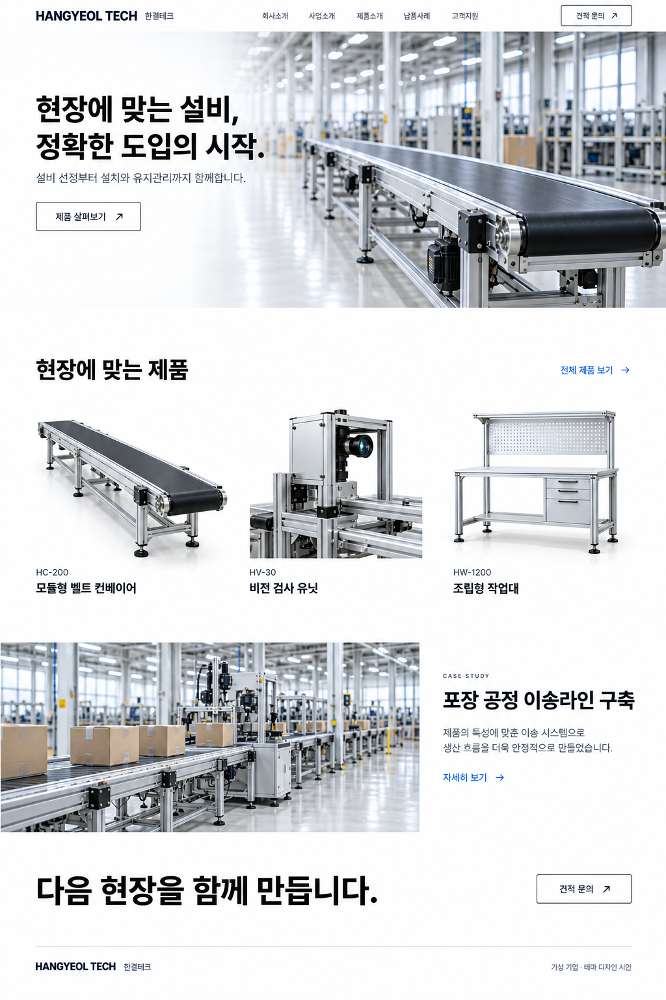
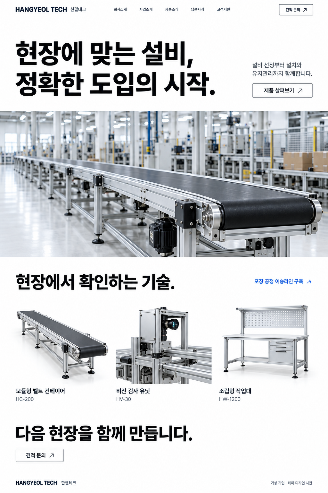
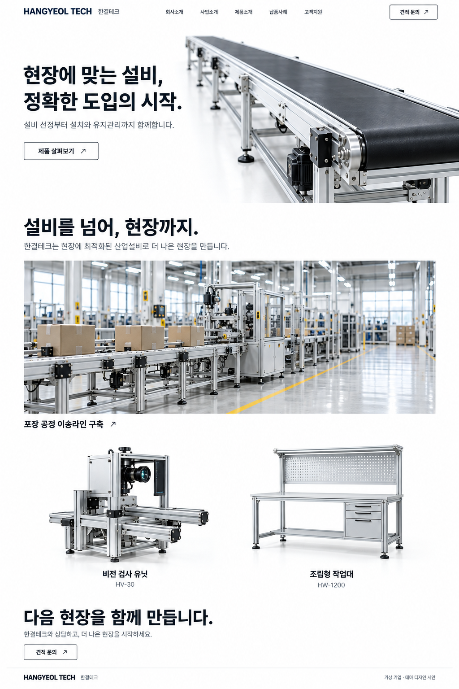

# JW BUSINESS 01 — 두 번째 디자인 시안
작성: 2026-09-09. 상태: 디자인 방향 선택 전. 내장 image_gen으로 이전 A/C 이미지와 사용자 피드백을 반영한 수정 시안 3종을 제작했습니다. 세 안의 이미지 크기는 assets.json에 기록했습니다.

## 반영한 사용자 판단

- 기존 C의 카탈로그형 구성은 탈락. 검색창·분류 아이콘 띠·홈 사양표를 이어받지 않습니다.
- 기존 B의 중하단 복잡한 분할, 작은 사진과 설명의 병렬 배치를 제거했습니다.
- A의 정돈된 구성과 C 히어로의 강한 제품 존재감을 출발점으로 삼았습니다.
- 사진을 제외한 페이지 바탕은 흰색. 크림·연회색·파랑 섹션, 진한 문의 띠와 어두운 푸터를 제외했습니다.
- 현대적인 고딕 글꼴·큰 제품 사진·여백·명료한 행동으로 강조합니다.
- 실제 제작 레포의 스택, 버튼, 아이콘, 스타일을 고려한다는 추가 지시를 최종 생성 프롬프트에 반영했습니다.

## 비교

| 시안 | 구성 | 판단 |
|---|---|---|
| 01 화이트 프리시전 | 현장 사진 히어로 → 제품 3개 → 구축 사례 → 문의 | A의 균형을 가장 충실히 다듬은 안. 일반 기업형 확장에 유리 |
| 02 타이포 파노라마 | 큰 제목 → 전체 폭 현장 사진 → 제품 3개 → 문의 | 한글 제목과 사진의 대비가 가장 강함. 구현 시 첫 화면에서 제목과 사진이 함께 보이도록 높이 조정 |
| 03 제품 스테이지 | 흰 공간의 초대형 제품 → 현장 사례 사진 → 보조 제품 2개 → 문의 | 이번 추천. 배경색 없이 제품 크기로 강조하며 가장 간결한 인상 |

03의 대표 컨베이어는 히어로에서 이미 강조하므로 아래에 같은 제품을 다시 반복하지 않았습니다. 02는 홈을 단순화했지만 실제 구현에서는 제품 영역과 사례 링크의 의미를 명확하게 분리합니다. 모든 제품·사례·고객지원 기능은 전체 메뉴와 내부 화면에서 제공합니다. 홈에서 작은 모듈을 줄이는 것이 제품 범위를 없애는 것은 아닙니다.

## 실제 저장소 스택과 연결

현재 확인한 코드: 루트 theme-stack.json, docs/theme-harness.md, docs/design-system.md, 테마 assets/base.css, packages 디렉터리.

| 항목 | 확인된 현재 상태 | 이번 시안·향후 구현 기준 |
|---|---|---|
| 스타일 | Tailwind 4.1.16, jw prefix, Preflight 미사용 | 흰 표면·글자·테두리·간격을 의미 토큰으로 구현. 섹션별 임의 CSS 중복 방지 |
| 런타임 | G7 공유 React 19.2.0, Vite IIFE | 실제 텍스트·링크·이미지·반복 노드로 구성하고 G7의 편집·저장을 유지 |
| 아이콘 | lucide-react 1.43.0 선택 기능 등록 | ArrowUpRight·ArrowRight 등 필요한 선형 아이콘만 정적 import. 이미지에서 생성된 화살표를 실제 자산으로 잘라 쓰지 않음 |
| 버튼 | 공통 Button 컴포넌트와 최종 토큰은 아직 미구현 | 세 안에 흰 외곽선 버튼과 텍스트 링크라는 같은 디자인안을 적용. 기본 높이 44~48px, 반경 4px, 1px 테두리, 라벨 16px, 아이콘 간격 8px를 선정 후 검증 |
| 간격 | 디자인 문서에 4/8 계열, 본문 폭 1200px, PC 섹션 간격 96px 등의 후보값 | 같은 토큰 체계로 시안을 구성. 이미지상 픽셀을 이미 구현·검증한 값으로 취급하지 않음 |
| 폰트 | 현재 system-ui, sans-serif. Pretendard는 패키지에 아직 내장되지 않음 | 별도 장식용 글꼴을 요구하지 않는 한국어 고딕 방향. Pretendard를 채택하면 로컬 폰트·고지까지 따로 동봉 |
| 효과 | Embla 8.6.0·Motion 13.2.0 선택 기능 | 정적 상태에서도 의미가 완결되게 설계. 슬라이더나 패럴랙스는 실제 필요에 따라 적용 |
| 복합 UI | interactive-ui는 probe-required | 호환 실증 전 복합 라이브러리 채택을 전제하지 않음. 현재 시안은 기본 링크·버튼·이미지·레이아웃으로 표현 가능 |
| 배포 | 테마별 자산 내장, CDN 금지 | 사진·CSS·JS·아이콘·채택 폰트를 자기 패키지에 포함 |

선형 화살표와 버튼을 일관되게 생성하도록 지시했지만 이미지 생성물의 모양은 근사치입니다. 실제 구현의 SVG 아이콘·버튼·focus/hover/disabled 상태는 위 공통 계약에서 만들고 화면과 대조해야 합니다. 이번 작업이 공통 UI 구현이나 하네스의 디자인 검사 완료를 뜻하지 않습니다.

## 시안

### 01 · 화이트 프리시전

### 02 · 타이포 파노라마

### 03 · 제품 스테이지 — 추천

## 확인과 다음 단계

흰 배경, 컬러 띠·어두운 푸터 부재, 정돈된 중하단, 큰 히어로 제품, 한국어 주요 제목을 시각적으로 확인했습니다. 사진 속 제품 형상·치수와 문구는 디자인용 예시이며 최종 데이터팩의 기술적 검증값이 아닙니다.

사용자가 선택한 안에 대해 토큰·버튼·아이콘 규칙과 모바일·제품 상세·게시판을 구체화한 뒤 실제 G7 화면을 구현합니다. 공통 UI가 이미 완성돼 있다고 가정하지 않고 첫 테마에서 필요한 최소 규칙부터 코드로 고정합니다.

내장 image_gen 사용. 스택 지시까지 포함한 실제 최종 프롬프트는 [final-prompts.json](final-prompts.json), 원본 출처·파일 해시는 [assets.json](assets.json)에 기록했습니다. 이전 시안은 보존했습니다.
