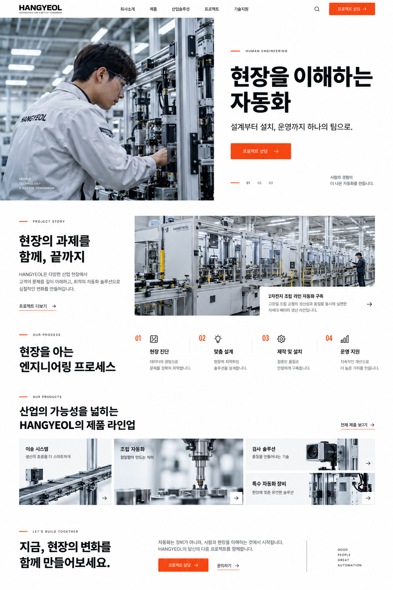
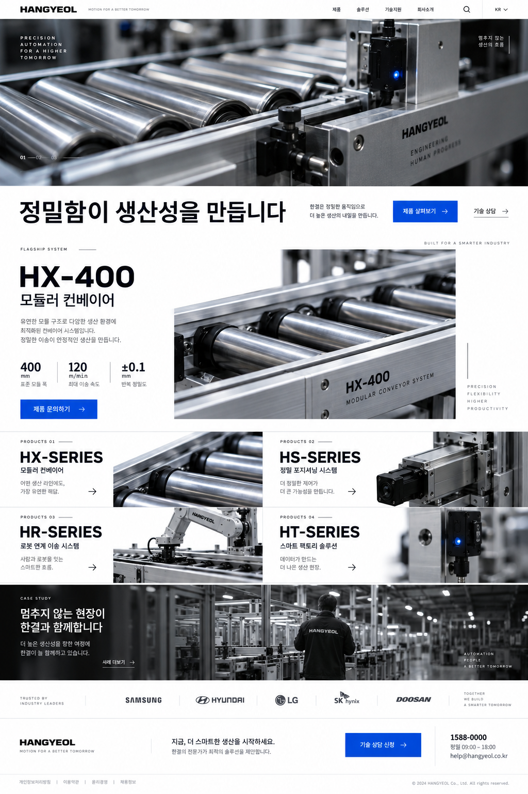
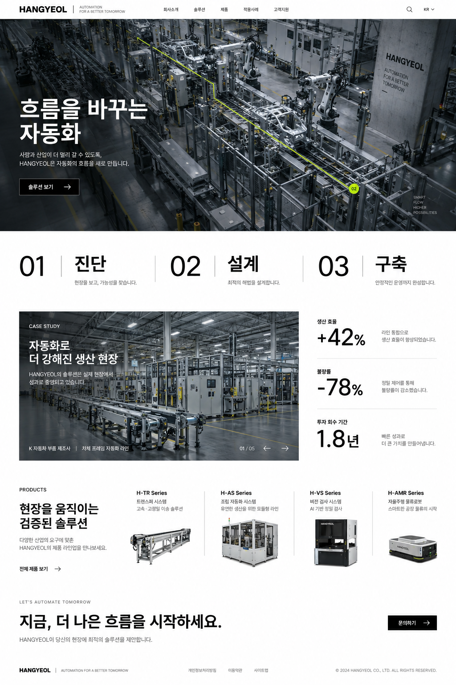

# JW BUSINESS 01 — 세 번째 디자인 시안

작성: 2026-09-09. 상태: 디자인 방향 선택 전.

두 번째 시안의 화면 골격을 재사용하지 않고 세 개의 조형 원리로 다시 제작했습니다. 기존 시안 이미지는 생성 참조로 넣지 않았습니다. 사진을 제외한 표면은 흰색이며, 컬러는 버튼·선·번호 등 작은 강조에만 사용합니다.

## 비교

| 시안 | 중심 개념 | 홈 구성 | 적합성 |
|---|---|---|---|
| 01 휴먼 엔지니어링 | 사람과 현장 이해 | 엔지니어 히어로 → 프로젝트 → 업무 과정 → 제품군 | 회사 신뢰와 기술 지원까지 보여주는 범용 비즈니스 테마에 가장 안정적 |
| 02 모뉴멘털 프리시전 | 제품 정밀도와 소재감 | 매크로 히어로 → 대표 제품 → 제품 인덱스 → 사례 | 제조사·장비업체의 제품 브랜드 인상을 가장 강하게 만듦 |
| 03 키네틱 오버뷰 | 생산 흐름과 구축 성과 | 전면 현장 히어로 → 진단·설계·구축 → 성과 사례 → 제품 인덱스 | 첫 화면 주목도와 현대성이 가장 강하며 산업 솔루션 설명에도 유리 |

## 이번 판단

- 01은 기존 A의 레이아웃을 복제하지 않고 사진과 텍스트 위치를 뒤집고, 제품보다 엔지니어링 파트너십을 앞세웠습니다.
- 02는 화면 전체를 정밀 장비 카탈로그처럼 구성했습니다. 동일 폭 카드 대신 대표 제품과 제품 인덱스의 위계를 나눴습니다.
- 03은 최초 생성안의 제목 위 파노라마 구성이 이전 시안과 닮아 폐기하고, 사진 안에 제목과 공정 경로를 결합한 전면형 히어로로 다시 만들었습니다.
- 추천 순위는 03, 01, 02입니다. 03이 C에서 유효했던 히어로 강조를 살리면서 중하단을 단순화합니다. 01은 여러 업종으로 확장할 때 가장 안전합니다.

## 스택 적용 기준

현재 스택은 표현을 제한하는 디자인 규칙이 아니라 구현 가능성을 확인하는 기준으로만 적용합니다.

- React와 Tailwind CSS의 grid, flex, absolute positioning으로 세 안을 모두 구현할 수 있습니다.
- 버튼은 공통 컴포넌트의 solid, outline, text 변형으로 만들 수 있습니다. 한 가지 외곽선 스타일로 고정하지 않습니다.
- 화살표·검색·메뉴는 Lucide 아이콘을 사용하고, 공정 경로는 단순 SVG 선으로 구현할 수 있습니다.
- Embla와 Motion은 필요한 상호작용에만 사용하며 정적 화면 구성의 전제가 아닙니다.
- 폰트·사진·CSS·JS·아이콘은 최종 테마 패키지에 내장하고 CDN을 사용하지 않습니다.

## 시안

### 01 · 휴먼 엔지니어링

### 02 · 모뉴멘털 프리시전

### 03 · 키네틱 오버뷰

## 다음 단계

선택된 한 안을 기준으로 색·타입·간격·버튼·아이콘·사진 비율을 디자인 규격으로 고정합니다. 그 뒤 데스크톱과 모바일 대표 화면을 실제 G7 구조로 구현합니다. 이미지 속 회사명·제품명·수치·사진은 방향 선택용 예시이며 레이아웃 데이터팩의 검증된 사업 정보로 사용하지 않습니다.

실제 생성 프롬프트는 [prompts.json](prompts.json), 파일 크기와 해시는 [assets.json](assets.json)에 기록했습니다.
