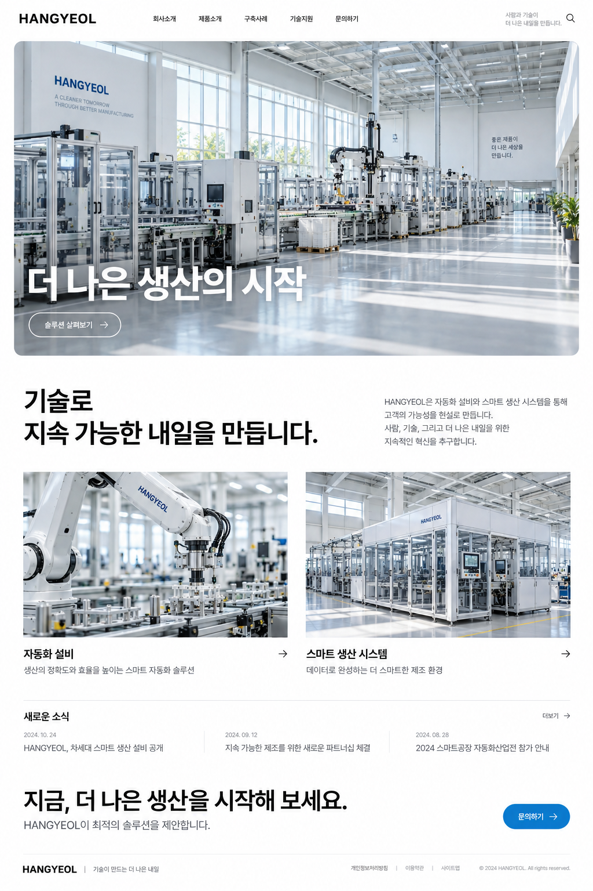
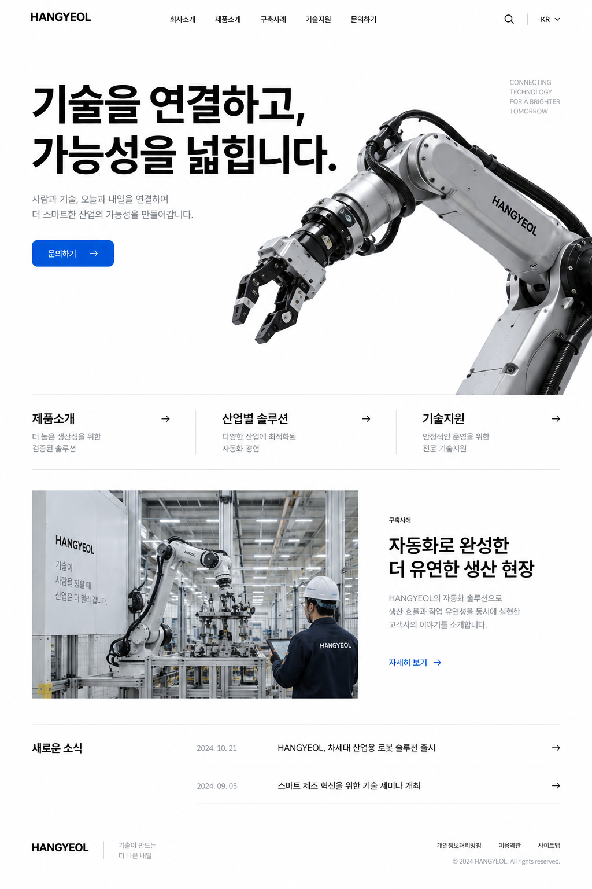
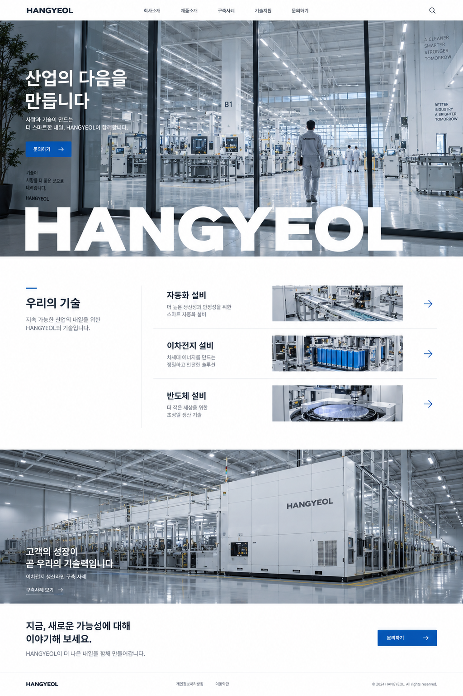

# JW BUSINESS 01 — 네 번째 시안

2026-09-09. 사용자 선택 전. 내장 image_gen으로 기존 이미지 참조 없이 3종 생성했습니다.

- A: 밝은 현장 사진을 크게 담은 프레임형. 제품 두 영역과 소식으로 간결하게 구성합니다.
- B: 흰 바탕에 대형 로봇 실루엣과 타이포그래피를 결합한 제품 중심형.
- C: 전면 현장 사진과 큰 워드마크, 목록형 제품 안내를 결합한 브랜드 중심형.

사진 외 영역은 흰 바탕입니다. 현재 React·Tailwind·Lucide로 표현할 수 있는 구성으로 계획했으며 실제 구현 검증은 선택 후 진행합니다. 사진 내 생성된 표기와 소식 날짜는 시안용으로, 실제 데이터팩에서는 검토된 내용으로 교체합니다.

실제 생성 프롬프트: [prompts.json](prompts.json).
