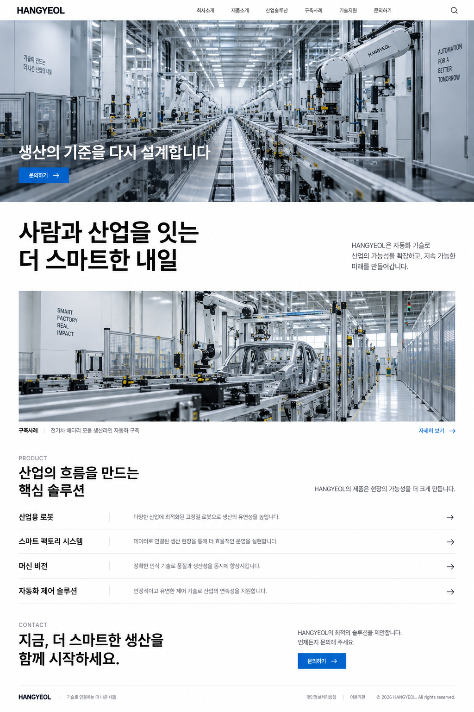
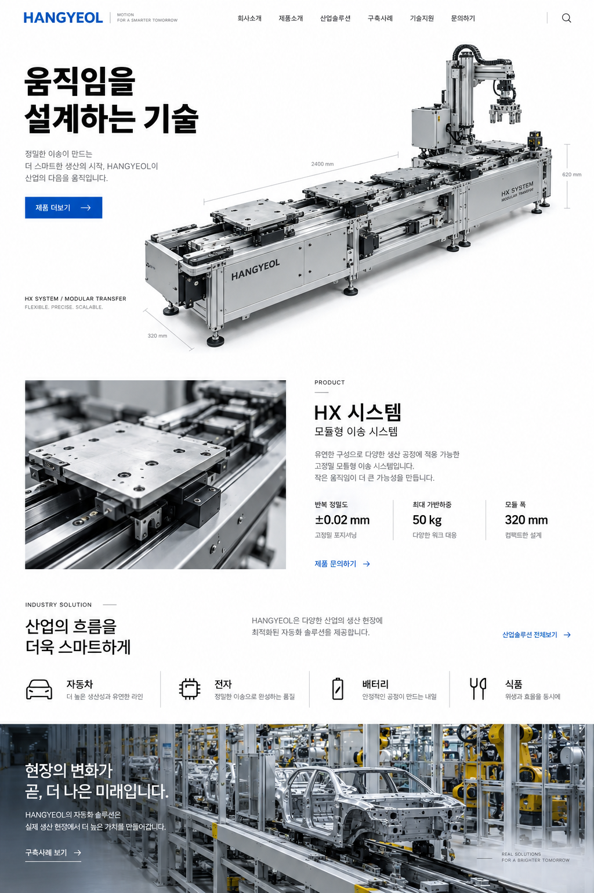
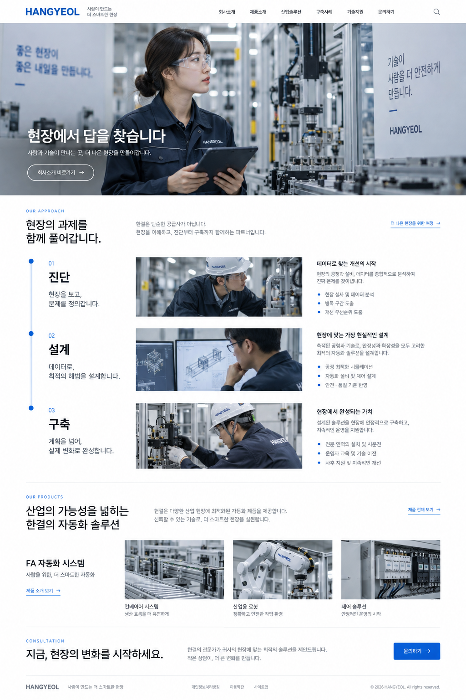

# JW BUSINESS 01 — 다섯 번째 디자인 시안

작성: 2026-09-09. 기존 시안 이미지를 참조하지 않고 새로 생성했습니다. 이번 세 안은 히어로 사진만 바꾼 변형이 아니라 콘텐츠 흐름 자체를 다르게 구성했습니다.

## 비교

| 안 | 조형 방향 | 정보 흐름 | 적합한 포지션 |
|---|---|---|---|
| A · Industrial Monograph | 대형 생산라인 사진과 매거진식 여백 | 히어로 → 기업 메시지 → 구축 사례 → 제품 목록 → 문의 | 가장 안정적인 회사형 테마 |
| B · Object / System | 흰 캔버스 위 단일 장비와 사양 중심 | 장비 히어로 → 대표 제품 상세 → 산업 분야 → 구축 사례 | 제품·장비 판매를 강조하는 기업 |
| C · People / Field | 엔지니어와 현장 협업을 중심으로 전개 | 현장 히어로 → 진단·설계·구축 → 제품군 → 상담 | 기술 컨설팅과 프로젝트 수주 중심 기업 |

A는 첫 테마의 기본형으로 가장 안전하고, B는 쇼핑몰·제품 상세 확장에 유리하며, C는 회사의 전문성과 신뢰를 보여주는 데 가장 강합니다.

## 구현 기준

세 안 모두 React, Tailwind CSS, Lucide 아이콘으로 구현할 수 있습니다. 버튼은 solid·outline·text 변형을 공통 컴포넌트로 두고, 이미지와 텍스트의 배치만 테마 조합으로 관리합니다. 사진 외 영역은 흰색을 유지하며 CDN 없이 테마 패키지에 자산을 포함합니다.

이미지 속 회사명·제품명·수치·소식은 디자인 확인용입니다. 실제 구현 때에는 분야별 레이아웃 데이터팩의 검토된 게시물·상품·이미지로 교체합니다.

## 시안

원문 프롬프트는 [prompts.json](prompts.json), 파일 크기와 해시는 [assets.json](assets.json)에 기록했습니다.
