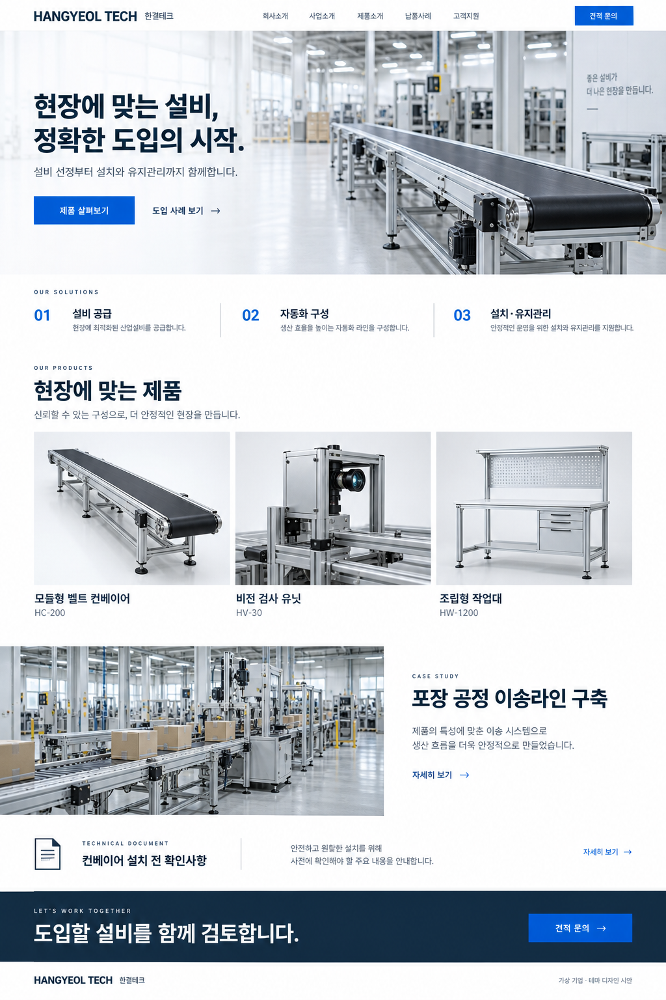
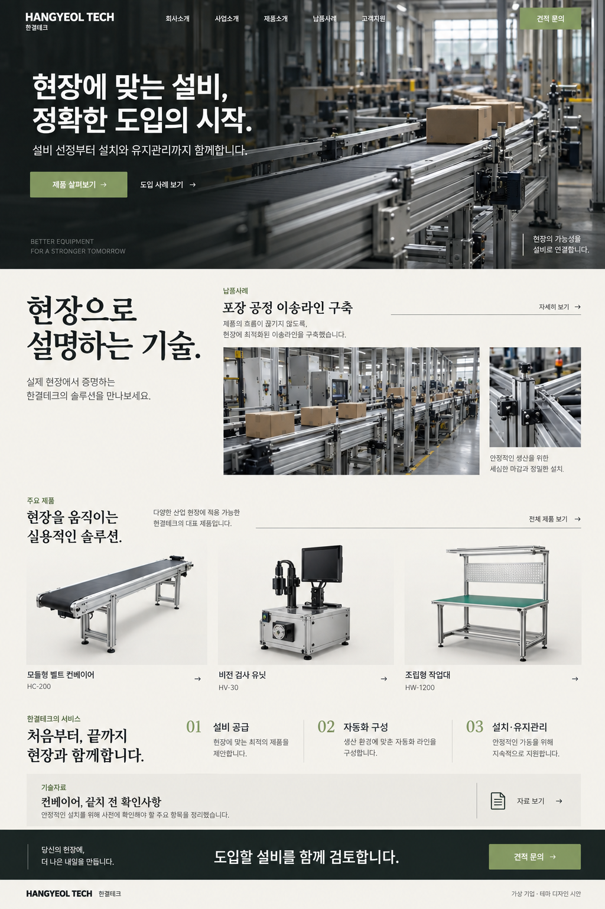
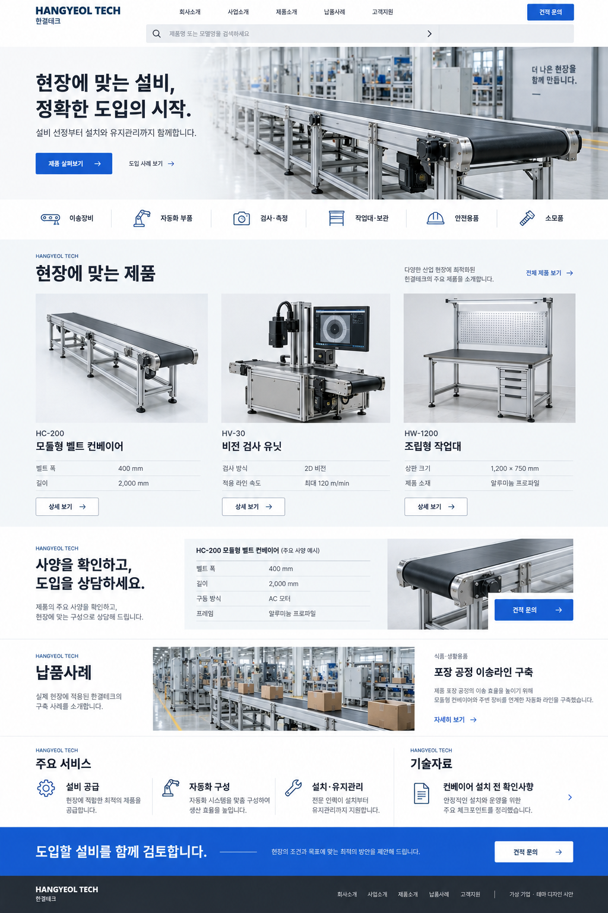

# JW BUSINESS 01 — 비즈니스 테마 조사와 디자인 3안
작성: 2026-09-09
상태: 선택 전 디자인 제안. 홈 PC 이미지 3안 생성 완료. 구현·모바일 검증·제품 데이터 설치 완료가 아님.

## 결론

첫 테마에는 **A · 정돈된 기술기업형**을 추천합니다. 제조·산업설비 기업의 회사 설명, 제품 탐색, 사례 확인, 문의를 균형 있게 배치하며 다른 기업 프로필로 확장할 때도 구조를 재사용하기 좋습니다. 이는 제품 기획에 대한 설계 판단이며 매출·전환율 실험 결과가 아닙니다.

B는 설치 현장과 프로젝트 이야기가 강한 기업에, C는 품목·모델·사양을 빠르게 찾으려는 방문자가 많은 기업에 적합합니다. 한 가지 레이아웃의 색상만 바꾸지 않고 콘텐츠의 우선순위와 사진·정보 밀도를 다르게 했습니다.

## 조사 범위와 관찰 근거

공개 상품 설명, 데모 정보 구조와 현재 브라우저 화면을 확인했습니다. 유료 소스·관리자 기능은 시험하지 않았고 전체 시장 판매 순위를 산출하지 않았습니다.

| 참고 대상 | 확인한 특징 | JW BUSINESS 01에 적용할 판단 |
|---|---|---|
| [위즈테마06_2026 상품](https://sir.kr/contents-mall/items/1584690430), [공개 데모](https://wiztheme.co.kr/theme06_re/) | 상품 페이지는 기업/회사 분류, 자동 메뉴와 수정 편의를 제시. 브라우저에서 전체 폭 현장 사진, 사진 위 메뉴와 큰 제목, 제품·회사소개·공지·문의 연결을 확인 | 현장 사진의 규모감과 명확한 기업 메뉴를 참고. 홈페이지 첫 화면에서 제품·사례로 갈 행동을 더 선명하게 제공 |
| [퓨어화이트 데모](https://sir-purewhite.websiting.kr/) | 공개 페이지에 회사소개·연혁·제품 갤러리·일반/Q&A/FAQ·자료실의 여러 유형을 제공 | 홈 한 장보다 내부 페이지와 게시판의 일관된 완성도가 상품 가치. 실제 데모 메뉴에는 구매자의 업무 용어 사용 |
| [Festo 한국](https://www.festo.com/kr/ko/) | 브라우저의 제품명·번호·카테고리 검색, 제품·솔루션·지원 탐색, 기술자료·엔지니어링 툴·추천 제품·문의 경로를 확인 | 산업 고객에게 제품 검색과 사양·자료 탐색이 독립된 핵심 동선. 회사소개만 긴 페이지로 구성하지 않음 |

위즈테마는 웹 텍스트 추출이 실패했지만 실제 브라우저 데모는 열어 관찰했습니다. 퓨어화이트는 텍스트 정보 구조 중심, Festo는 렌더된 검색·메뉴와 접근성 트리를 확인했습니다. 출처별 관찰 수준을 동일하게 취급하지 않습니다.

최근성은 위즈테마의 2026년 개정 상품과 현재 운영 중인 산업기업 사이트를 참고했습니다. 이것을 전체 웹디자인의 유행 순위나 판매 성과의 원인으로 단정하지 않습니다.

## 공통 콘텐츠와 시안 범위

- 가상 사업체: 한결테크 / HANGYEOL TECH. 이번 비교용 이름이며 실제 기업이나 확정 상표가 아님.
- 핵심 제목: 현장에 맞는 설비, 정확한 도입의 시작.
- 사업: 설비 공급, 자동화 구성, 설치·유지관리.
- 대표 제품: HC-200 모듈형 벨트 컨베이어, HV-30 비전 검사 유닛, HW-1200 조립형 작업대.
- 사례: 포장 공정 이송라인 구축.
- 자료: 컨베이어 설치 전 확인사항.
- 행동: 제품 살펴보기 → 사양·사례 → 견적 문의.
- 메뉴: 회사소개 / 사업소개 / 제품소개 / 납품사례 / 고객지원.
- 세 시안 모두 AI로 새로 생성한 이미지. 경쟁사의 사진·코드·디자인을 복제하지 않음.

기업·제품명과 콘텐츠 역할은 통일했지만 생성 사진 속 장비의 세부 형상은 시안마다 다릅니다. 제품 사진·사양은 아직 확정 데이터팩 자산이 아니며 선정 후 같은 원본으로 통일합니다. 특히 C의 치수·속도·사양은 시안용 예시이며 제품 검증값이 아닙니다. 이미지 속 추가 문구도 콘텐츠팩의 최종 승인 문구로 취급하지 않습니다.

## 세 가지 패턴

| 항목 | A · 정돈된 기술기업형 | B · 현장·사례 중심형 | C · 제품 카탈로그 중심형 |
|---|---|---|---|
| 주된 인상 | 밝고 정확한 기술 파트너 | 현장 경험과 시공 역량 | 제품을 찾기 쉬운 전문 공급사 |
| 첫 화면 | 밝은 현장 사진, 제품과 문의 행동 | 어두운 현장 사진, 강한 한글 제목 | 낮은 히어로, 검색·분류를 빠르게 노출 |
| 콘텐츠 순서 | 사업 → 제품 → 사례 → 자료 → 문의 | 사례 → 제품 → 사업 → 자료 → 문의 | 검색·분류 → 제품·사양 → 사례 → 지원 |
| 표현 | 화이트·네이비·블루, 고딕, 선과 여백 | 차콜·웜화이트·올리브, 일부 명조, 비대칭 편집 | 화이트·쿨그레이·블루, 고딕, 정렬된 사양 |
| 강점 | 첫 기업형 테마의 범용성과 균형 | 사진과 사례의 차별성이 잘 드러남 | 여러 제품 비교·상세 진입이 빠름 |
| 주의점 | 평범해지지 않도록 사진·글자·간격 정밀도 필요 | 원본 현장 사진 품질에 크게 의존 | 상품이 적거나 서비스 위주인 기업에는 밀도가 과함 |
| 확장 적합성 | 제조·IT·물류·기업 서비스 | 설비 설치·건설·프로젝트 기업 | 산업용품·부품·장비 유통 |

### A · 추천

기업 설명과 제품·사례 사이의 균형이 첫 상품 기획에 가장 적합합니다. 제품 사진 3열과 넓은 사례 영역을 분리하여 회사 홈페이지의 인상을 유지합니다.

### B

사례를 제품보다 먼저 배치합니다. 명조 제목과 따뜻한 바탕은 A·C와 다른 편집 인상을 줍니다. 실제 적용 시 올리브 버튼의 글자 대비를 측정해 토큰을 조정해야 합니다.

### C

검색·제품 분류·사양을 초반에 제공합니다. 첫 팩의 제품 18개와 목록 2페이지를 보여주기 좋습니다. 검색·옵션 선택은 반드시 G7 실제 데이터와 연결합니다.

## 선택 후 구현 기준

1. 사용자가 A/B/C 중 기준 방향을 선택합니다. 원하는 조합이 있으면 예를 들어 A의 기업형 골격에 C의 제품 탐색을 적용할 수 있습니다.
2. 선택 이미지에서 색상·서체·글자 크기·본문 폭·간격·사진 비율·모서리·아이콘 규칙을 수치로 고정합니다. 이미지의 색·폰트를 측정 없이 확정값으로 보고하지 않습니다.
3. 모바일 홈, 제품 상세와 옵션, 사례 상세, 게시판 목록·본문을 같은 규칙으로 구체화합니다. PC 이미지를 단순 축소하지 않습니다.
4. 먼저 대표 G7 페이지를 구현해 이미지와 비교하고 반응형·키보드·편집·저장 동작을 확인한 뒤 나머지 페이지로 확장합니다.
5. 사진은 UI와 분리한 원본 자산으로 만들고, 문구·이미지·제품·게시판은 검토된 레이아웃 데이터팩을 실제 삽입해 표시합니다.

시안 이미지는 디자인 기준 자료입니다. 홈페이지 전체를 한 장의 배경 이미지로 넣지 않습니다. 제목·버튼·제품·게시판은 편집 가능한 실제 구성 요소로 구현합니다.

## 인터랙션 제안

- A: 짧은 제목 등장, 제품 링크 hover, 사례 진입의 절제된 reveal.
- B: 현장 이미지의 느린 이동 또는 작은 깊이 변화, 사례 이미지 전환.
- C: 검색·분류 피드백, 사양 선택과 문의에 선택값 전달.
- 자동 슬라이더와 패럴랙스는 기본 필수가 아닙니다. Motion·Embla는 필요한 화면에서 채택하고 reduced motion에서 내용을 즉시 표시합니다.
- 모든 라이브러리·CSS·아이콘·폰트는 테마 패키지 내부에 포함합니다.

## 생성 기록

내장 image_gen 사용. 최종 프롬프트 3개는 [prompts.json](prompts.json)에 저장했습니다. 실제 생성 결과는 각 1024×1536 PNG입니다. 홈 PC 구성 선택용이며 모바일 시안은 아직 없습니다.
